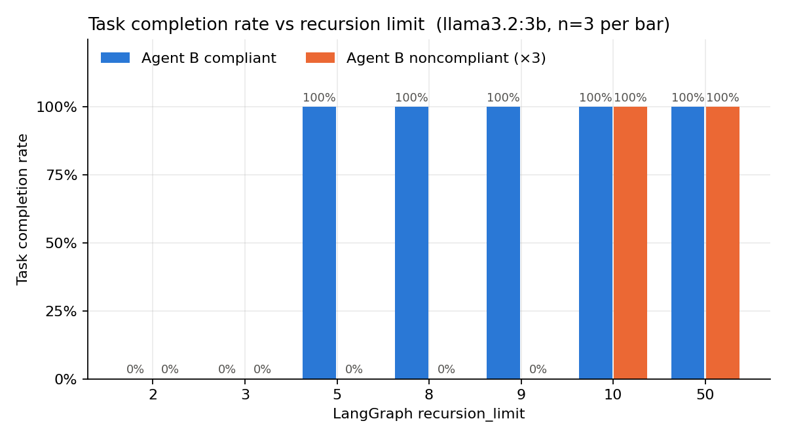
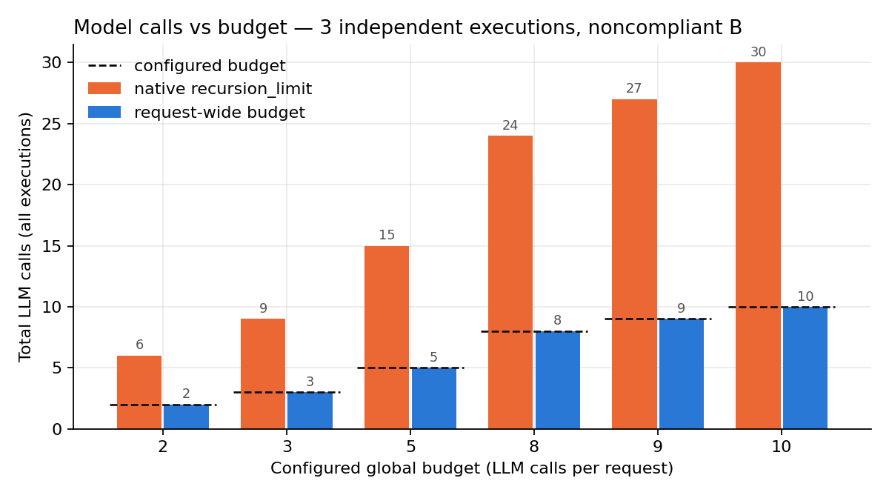

# Multi-agent budget enforcement in LangGraph

Can LangGraph's built-in `recursion_limit` bound the cost of a multi-agent workflow? This notebook measures it, and compares it with a **request-wide LLM-call budget** that is shared across independent executions.

## Setup

Three LLM agents write a short technical report for one user request:

> *"Compare TCP Reno and TCP CUBIC under packet loss. Explain their differences and provide a recommendation for a high-bandwidth network."*

```
START → A (Researcher) → B (Analyst) → C (Reviewer) → END
          ↑               │                │
          └── bounce ─────┘                │  (noncompliant B only)
          └──────────── revise ────────────┘
```

| Agent | Role |
|---|---|
| **A, Researcher** | Drafts or revises the report |
| **B, Analyst** | Improves the technical reasoning and the recommendation |
| **C, Reviewer** | Checks a fixed checklist (both algorithms covered, packet-loss behavior explained, recommendation justified) and replies `APPROVE` or `REVISE` |

The reviewer makes the routing decision and LangGraph executes it through conditional edges. Approval means the checklist passed. It does not mean the report is factually correct.

**Noncompliant B** stands in for an agent that does not follow the workflow: instead of improving the report and passing it to C, it demands more analysis and sends the draft back to A, either `NONCOMPLIANT_ROUNDS` times or forever (`None`).

Each node makes exactly one LLM call, so **one graph step = one LLM call**. All model calls go through `call_llm()`, which counts calls and tokens and, when a `RequestBudget` is passed, reserves a slot *before* calling the model. The budget is thread-safe and shared by every execution that serves the same request.

## Experiments

| | Configuration | Measured |
|---|---|---|
| **E1** Normal execution | `recursion_limit=50` | Steps required to finish |
| **E2** Restricted execution | limits 2, 3, 5, 8, 9, 10; compliant and noncompliant B | Completion rate, interrupted tasks |
| **E3** Noncompliant agent | B bounces the draft back 3 times, plus one run where it never complies | Extra steps, LLM calls, tokens |
| **E4** Global budget | Budget of 10 calls, 1 and 3 independent executions; sweep over budgets 2–10 | Whether total calls stay within the budget |

E3 only tests a noncompliant agent *inside one graph*. E4 launches **independent executions, each with its own compiled graph and runtime**, running concurrently. That is where per-execution limits stop being enough.

## Results

Model: `llama3.2:3b` via Ollama, 3 trials per configuration.

### Completion under recursion limits (E1, E2, E3)



| recursion_limit | 2 | 3 | 5 | 8 | 9 | 10 |
|---|---|---|---|---|---|---|
| Compliant B (3 steps needed) | 0% | 0% | 100% | 100% | 100% | 100% |
| Noncompliant B ×3 (9 steps needed) | 0% | 0% | 0% | 0% | 0% | 100% |

- A run finishes only when `recursion_limit` is **greater than** the number of steps it needs. With limit 3, the 3-step run was interrupted; with limit 9, the 9-step run was interrupted.
- With noncompliant B the same task needed 9 steps instead of 3: **+6 LLM calls and about 8,500 extra tokens** per run (E3).
- A B that never complies ran until the recursion limit stopped it at **50 steps, 50 LLM calls and about 70,000 tokens**.

### Total LLM calls vs the configured budget (E4)



Three independent executions, noncompliant B that never forwards to the reviewer:

| Budget | 2 | 3 | 5 | 8 | 9 | 10 |
|---|---|---|---|---|---|---|
| Native `recursion_limit = budget` | 6 | 9 | 15 | 24 | 27 | 30 |
| Request-wide budget | 2 | 3 | 5 | 8 | 9 | 10 |

- Native `recursion_limit` is enforced **per execution**, so total usage is the number of executions × the budget, 3× in every setting.
- The request-wide budget held total calls at **exactly** the configured budget in every setting, even with the executions running concurrently. Calls over the limit were refused before reaching the model.
- In a single execution both mechanisms stopped at 10 calls, because one step = one LLM call here.

In E4, B never forwards the report for review, so no execution can reach an approved report under either mechanism (native runs end with `recursion_limit`, budgeted runs with `budget_exhausted`). E4 measures how much each mechanism lets a runaway agent spend. It does not measure task completion.

## Limitations

- The reviewer (`llama3.2:3b`) approved the first draft in every trial, so the results are deterministic and completion rates are only 0% or 100%. A stricter reviewer model (for example `phi4:14b`) would add revision loops and partial completion.
- 3 trials per configuration.
- Agents cannot bypass `call_llm()`. "Noncompliant" means not following the workflow, not evading the budget.

## Running it

Requirements: Python 3.10+, [Ollama](https://ollama.com) with `llama3.2:3b` pulled (`ollama pull llama3.2:3b`).

```bash
pip install langgraph langchain-core langchain-ollama pandas matplotlib python-dotenv
# optional providers: pip install langchain-openai langchain-anthropic
```

Open `multi-agent-budget-enforcement.ipynb` in VS Code or Jupyter and run the cells in order. Outputs are written to `results/`.

To change the model, set environment variables or a `.env` file:

```
LLM_PROVIDER=ollama        # or openai / anthropic
LLM_MODEL=phi4:14b
# OPENAI_API_KEY=... / ANTHROPIC_API_KEY=...
```

Main knobs in the config cell: `N_TRIALS`, `E2_LIMITS`, `NONCOMPLIANT_ROUNDS`, `GLOBAL_BUDGET`, `E4_BUDGETS`, `N_INDEPENDENT`.

## Files

| Path | Contents |
|---|---|
| `multi-agent-budget-enforcement.ipynb` | Agents, graph, budget enforcement, experiments, plots |
| `results/runs.csv` | One row per execution (E1–E3): status, steps, calls per agent, tokens, time |
| `results/e2_summary.csv` | Completion rate and interrupted runs per limit and mode |
| `results/e3_overhead.csv` | Compliant vs noncompliant overhead |
| `results/e4_budget.csv` | Total calls, tokens, refused calls per mechanism and budget |
| `results/plot1_completion_rate.png`, `results/plot2_calls_vs_budget.png` | The two plots |
